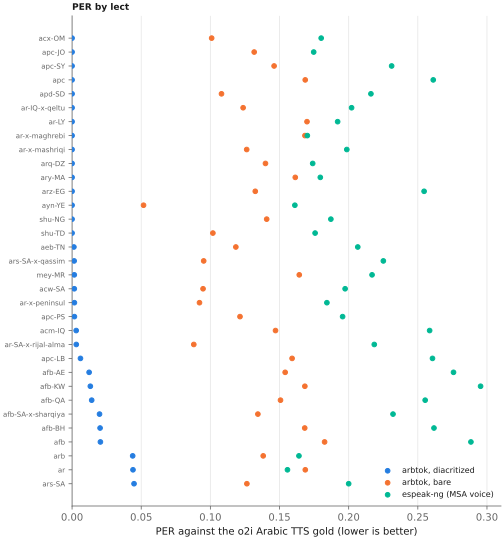

# Per-lect benchmarks

<!-- agent-hint
covers: how the per-lect benchmark scores arbtok, the figures it reaches and what they can claim
source: benchmarks/lect_results.json, benchmarks/lect_results_full_irab.json, scripts/benchmark_stack.py, scripts/benchmark_gold20.py, scripts/benchmark_iqraeval.py
generated: no
verify: for f in $(grep -oP 'scripts/\w+\.py' docs/benchmarks.md | sort -u); do test -f $f || exit 1; done && .venv/bin/python -m pytest -q tests/test_lect_benchmark.py
see: rawi-fusion.md, gold-code-switched.md
-->

Two benchmarks live in `scripts/benchmark_stack.py`.

- **default mode**, the MSA stack question: is arbtok better than its parts and
  than espeak-ng on the WikiPron `ara_arab_broad` word set? See the module
  docstring.
- **`--lect` mode**, the dialect question this page reports: does a *dialect*
  sentence, diacritized or bare, come out the way the requested lect's cited
  rules say it should?

```
python scripts/benchmark_stack.py --lect                     # every lect, full gold
python scripts/benchmark_stack.py --lect --json out.json     # + machine-readable
python scripts/benchmark_stack.py --lect --lects ar-EG,ar-MA # a subset
python scripts/benchmark_stack.py --lect --no-espeak         # arbtok arms only
```

## What the gold is, and what it is not

The gold is orthography2ipa's Arabic TTS set (`data/gold/arabic_tts`, o2i #358):
one TSV per lect, sentence-level, with a vocalized `sentence`, its bare `raw`
skeleton, and a reference `ipa`. It covers every Arabic lect orthography2ipa
ships a spec for, twenty sentences each. The table below reports a run over all twenty
sentences per lect.

**Its provenance is load-bearing and must be quoted with every number.** The
reference IPA is **LLM-generated from the specs' cited rules, then
rule-anchored**, it is an o2i-regression snapshot, **not native-speaker-validated
ground truth.** So every figure here is *engine similarity to cited-rule o2i
output*: a lect where arbtok scores well means "arbtok reproduces what o2i's
rules predict for it", never "a native speaker signed off". Native word-level
gold is what would turn these into truth claims. Until then, read these as a
consistency check between arbtok's lattice and the specs it consults.

espeak-ng has **no dialect voices**, so every lect is scored against its single
`ar` (MSA) voice. That is honestly apples-to-oranges, espeak is not being asked
the dialect question, it has no way to answer it, and the gap is the point, not
a fair contest. espeak is fed the *vocalized* sentence (vowels handed to it),
which if anything flatters the baseline.

## Metrics

Both sides are stress-stripped and punctuation-stripped before scoring.

- **PER**, character edit distance / gold characters, over the whole lect.
- **WER**, word edit distance / gold words. A TTS voice gets no partial credit
  for a word it mispronounces, so WER is the harsher, more honest headline.

Two arbtok arms run the full default stack (diacritizer + stem lexicon) on the
variety's own spec:

- **diac**, input is the vocalized `sentence` (the marks are already there).
- **bare**, input is the `raw` abjad skeleton. The diacritizer must restore the
  vowels the writing omits. This is the everyday-input question.
- **ΔPER** = bare − diac: the price of the missing harakat, per lect.

## Results (full gold, 20 sentences per lect, default stem lexicon)

`benchmarks/lect_results.json` holds the run, written by
`python scripts/benchmark_stack.py --lect --json benchmarks/lect_results.json`.
The figure and the table read that file. The run scores the 33 gold lects that
arbtok reads. The gold also has `xaa` (Andalusian Arabic), which arbtok does not
read.

<picture>
  <source media="(prefers-color-scheme: dark)" srcset="img/lect-benchmark-dark.svg">
  
</picture>

`img/plot_lect_benchmark.py` makes this figure from `benchmarks/lect_results.json`.

Sorted best to worst by arbtok diacritized PER.

| Lect | Tier | N | arbtok PER (diac) | arbtok WER (diac) | arbtok PER (bare) | arbtok WER (bare) | ΔPER (bare−diac) | espeak PER | espeak WER |
|---|---|---|---|---|---|---|---|---|---|
| acx-OM | research | 20 | 0.000 | 0.000 | 0.101 | 0.339 | +0.101 | 0.180 | 0.532 |
| apc-JO | research | 20 | 0.000 | 0.000 | 0.132 | 0.504 | +0.132 | 0.175 | 0.480 |
| apc-SY | research | 20 | 0.000 | 0.000 | 0.146 | 0.537 | +0.146 | 0.231 | 0.585 |
| apc | research | 20 | 0.000 | 0.000 | 0.169 | 0.646 | +0.169 | 0.261 | 0.626 |
| apd-SD | research | 20 | 0.000 | 0.000 | 0.108 | 0.383 | +0.108 | 0.216 | 0.534 |
| ar-IQ-x-qeltu | research | 20 | 0.000 | 0.000 | 0.124 | 0.458 | +0.124 | 0.202 | 0.495 |
| ar-LY | research | 20 | 0.000 | 0.000 | 0.170 | 0.540 | +0.170 | 0.192 | 0.532 |
| ar-x-maghrebi | research | 20 | 0.000 | 0.000 | 0.168 | 0.551 | +0.168 | 0.170 | 0.469 |
| ar-x-mashriqi | research | 20 | 0.000 | 0.000 | 0.126 | 0.402 | +0.126 | 0.199 | 0.536 |
| arq-DZ | research | 20 | 0.000 | 0.000 | 0.140 | 0.467 | +0.140 | 0.174 | 0.449 |
| ary-MA | research | 20 | 0.000 | 0.000 | 0.161 | 0.554 | +0.161 | 0.179 | 0.509 |
| arz-EG | research | 20 | 0.000 | 0.000 | 0.132 | 0.480 | +0.132 | 0.255 | 0.585 |
| ayn-YE | research | 20 | 0.000 | 0.000 | 0.052 | 0.171 | +0.052 | 0.161 | 0.486 |
| shu-NG | research | 20 | 0.000 | 0.000 | 0.141 | 0.395 | +0.141 | 0.187 | 0.596 |
| shu-TD | research | 20 | 0.000 | 0.000 | 0.102 | 0.361 | +0.102 | 0.176 | 0.475 |
| aeb-TN | research | 20 | 0.001 | 0.008 | 0.118 | 0.442 | +0.117 | 0.207 | 0.651 |
| ars-SA-x-qassim | research | 20 | 0.002 | 0.009 | 0.095 | 0.357 | +0.094 | 0.225 | 0.539 |
| mey-MR | research | 20 | 0.002 | 0.009 | 0.164 | 0.536 | +0.163 | 0.217 | 0.609 |
| acw-SA | research | 20 | 0.002 | 0.010 | 0.095 | 0.337 | +0.093 | 0.197 | 0.538 |
| ar-x-peninsul | research | 20 | 0.002 | 0.010 | 0.092 | 0.313 | +0.090 | 0.184 | 0.485 |
| apc-PS | research | 20 | 0.002 | 0.010 | 0.121 | 0.564 | +0.120 | 0.196 | 0.475 |
| acm-IQ | research | 20 | 0.003 | 0.009 | 0.147 | 0.519 | +0.144 | 0.259 | 0.774 |
| ar-SA-x-rijal-alma | research | 20 | 0.003 | 0.018 | 0.088 | 0.312 | +0.085 | 0.219 | 0.509 |
| apc-LB | research | 20 | 0.006 | 0.037 | 0.159 | 0.541 | +0.153 | 0.261 | 0.670 |
| afb-AE | research | 20 | 0.012 | 0.074 | 0.154 | 0.509 | +0.142 | 0.276 | 0.676 |
| afb-KW | research | 20 | 0.013 | 0.076 | 0.168 | 0.514 | +0.155 | 0.295 | 0.743 |
| afb-QA | research | 20 | 0.014 | 0.085 | 0.151 | 0.447 | +0.137 | 0.255 | 0.798 |
| afb-SA-x-sharqiya | research | 20 | 0.020 | 0.120 | 0.134 | 0.444 | +0.115 | 0.232 | 0.583 |
| afb-BH | research | 20 | 0.020 | 0.121 | 0.168 | 0.495 | +0.148 | 0.262 | 0.673 |
| afb | research | 20 | 0.020 | 0.125 | 0.183 | 0.604 | +0.162 | 0.288 | 0.740 |
| arb | research | 20 | 0.044 | 0.216 | 0.138 | 0.840 | +0.094 | 0.164 | 0.544 |
| ar | research | 20 | 0.044 | 0.208 | 0.169 | 0.815 | +0.125 | 0.156 | 0.562 |
| ars-SA | research | 20 | 0.045 | 0.125 | 0.126 | 0.337 | +0.082 | 0.200 | 0.538 |

## Interpretation

**Diacritized path: arbtok reproduces the specs and beats the MSA baseline on
every lect.** With the marks present, arbtok's PER is 0.000 to 0.045, and
espeak-ng's MSA voice is 0.16 to 0.30. This is mostly self-consistency: the
reference IPA comes from the same cited spec rules that arbtok's lattice reads.
A low number confirms that the lattice runs the specs. It is not independent
evidence about native speech. espeak has no reflexes for qāf→/g/, gīm→/g/, the
interdental shifts or imāla, so it misses the segments that define a dialect.
Fifteen lects score PER 0.000 on this path, among them Omani `acx-OM`,
Jordanian `apc-JO` and Syrian `apc-SY`.

**The worst diacritized rows are `ars-SA` (0.045), `ar` (MSA, 0.044) and `arb`
(Classical, 0.044).** `ar` and `arb` have WER 0.21 and 0.22. Their gold sentences
keep the full iʿrāb case endings and hamzat-waṣl, which arbtok's pausal TTS
default removes. This is a register difference, not a dialect rule failure (see
the next section).

**Undiacritized path: removing the harakat adds 0.05 to 0.17 PER.** The
MSA-trained diacritizer and stem lexicon do not know dialect vowels, so the
bare input is where the dialect work remains. The largest additions are Libyan
`ar-LY` (+0.170), Levantine `apc` (+0.169), `ar-x-maghrebi` (+0.168) and
Mauritanian `mey-MR` (+0.163). The smallest is Yemeni `ayn-YE` (+0.052).

**On the bare path, arbtok beats espeak on every lect except `ar`.** For `ar`,
espeak's PER (0.156) beats arbtok's bare PER (0.169). espeak is tuned for MSA,
so on that one target arbtok's diacritizer adds errors. Where espeak comes
close on a dialect (`ar-LY`, `ar-x-maghrebi`, `ary-MA`), it scores an MSA
reading against a dialect gold and matches the shared segments.

### The MSA rows are a register difference, and the waqf policy sets it

The `ar` and `arb` gold keeps the full iʿrāb. arbtok's default is the pausal
(waqf) policy, `ArbtokG2PPlugin(pausal=True)`, Wright I §372, which drops the
endings that a TTS voice does not read out. With the gold's register
(`--full-irab`, that is `pausal=False`), almost all of the gap goes.
`benchmarks/lect_results_full_irab.json` holds that run:

| Lect | mode | PER (diac) | WER (diac) | PER (bare) | WER (bare) |
|---|---|---|---|---|---|
| ar  | pausal (default) | 0.044 | 0.208 | 0.169 | 0.815 |
| ar  | `--full-irab`    | **0.001** | **0.008** | 0.044 | 0.185 |
| arb | pausal (default) | 0.044 | 0.216 | 0.138 | 0.840 |
| arb | `--full-irab`    | **0.001** | **0.008** | 0.030 | 0.160 |

The waqf policy is one flag, read in one place (`arbtok.sandhi`), and both modes
run the same lattice.

## Why these are reported, not gated

These are engine-similarity numbers on an LLM-origin gold, so they are reported,
not used as a pass/fail gate. A CI regression gate belongs on native word-level
gold. Wiring `--lect` into CI against this gold would only gate arbtok against its
own specs. `tests/test_lect_benchmark.py` pins that the runner works (2 lects × 3
sentences, no network), not any score.

## The test suite's gold

The test suite pins a gold sentence set with a character error rate (CER) of at
most 5% against the reference transcriptions, and it benchmarks against
espeak-ng. See `tests/test_ipa_fuzzy.py`.

## IqraEval Qur'anic gold (`scripts/benchmark_iqraeval.py`)

The gold is
[`IqraEval/Iqra_train`](https://huggingface.co/datasets/IqraEval/Iqra_train)
(74k rows, built for the IqraEval Qur'an-recitation-assessment shared task).
Only its text columns are read — `sentence` (bare), `tashkeel_sentence`
(fully diacritized) and `phoneme_ref` (a custom phoneme notation) — via
`pyarrow` column projection over `huggingface_hub.HfFileSystem`, so the
multi-gigabyte `audio` column is never fetched. **No gold is vendored**;
`scripts/.cache_iqraeval/` is a run-time HTTP cache, gitignored like
`benchmark_gold20.py`'s own cache dir.

`phoneme_ref` turned out to be Nawar Halabi's Arabic-Phonetiser output notation
(the rule-based G2P vendored as `mantoq/buck/phonetise_buckwalter.py` in
phoonnx's thirdparty tree, adapted from
[nawarhalabi/Arabic-Phonetiser](https://github.com/nawarhalabi/Arabic-Phonetiser),
CC BY-NC 4.0) — verified symbol-by-symbol against all 67 distinct tokens found
in a 5,050-row sample (full dev split + 2,462 train rows); see
`benchmark_iqraeval.NOTATION` and its module docstring for the full mapping
table and citation.

**Provenance caveat — partially competitor-derived.** Running the vendored
Halabi phonetiser on a gold row's `tashkeel_sentence` reproduces the same
notation family (`f ii0 h i0 + ...` vs the gold's `f ii h i ...`): the gold's
base layer IS Halabi's rule engine, post-processed (stress digits and word
separators removed, cross-word tajwid sandhi such as idgham gemination
applied, in a recitation-assessment task grounded in audio). A PER against it
therefore partly measures disagreement with Halabi's rules, not correctness
alone — the same class of caveat orthography2ipa applies to espeak-derived
gold. The tajwid layer and audio grounding make it stronger than raw G2P
output, but it cannot by itself certify a pronunciation Halabi's rules get
wrong.


### Results

Two arbtok arms, `register="full"` (continuous Qur'anic recitation keeps case
endings; arbtok's spoken-register `pausal` default would drop them):

| split | arm | input | PER |
|---|---|---|---|
| dev (2,588 rows, full) | diac | `tashkeel_sentence`, `diacritize=False` | 0.132 |
| dev (2,588 rows, full) | bare | `sentence`, `diacritize=True` | 0.166 |
| train (5,000-row sample) | diac | `tashkeel_sentence`, `diacritize=False` | 0.133 |
| train (5,000-row sample) | bare | `sentence`, `diacritize=True` | 0.163 |

The dev and 5k train sample agree closely, so the dev split (scored in full) is
the number to cite. **Convention-adjusted PER** — dev `diac`, after excluding
the two confusion classes below that are documented tajwīd conventions rather
than arbtok errors — is **0.098** (raw 0.132), from the top-20 gold→pred
character-substitution counts (a `difflib`-based diagnostic, not a full
re-score; see caveat below).

### Honesty: real gaps vs recitation-convention mismatches

Qur'anic recitation gold encodes tajwīd conventions a plain-MSA/Classical G2P
has no reason to reproduce. Classified from the top-20 confusion pairs
(dev, `diac` arm):

**Excluded as documented recitation conventions:**

- `'ː' → {n, l, j, b, r, d, m, s, t}` (dev: 2,555 of 13,011 error chars; train
  5k: similar share) — gold gemination the arbtok output doesn't produce at a
  word junction. The likely source is Qur'an-specific **idghām/ikhfāʾ** rules
  for nūn sākinah/tanwīn before the throat and "ikhfāʾ" letter classes — a
  tajwīd-only elaboration on top of the general assimilation arbtok's
  `arbtok.sandhi` already models (`min baʿd → membaʕd`, tested in
  `scripts/metrics.py`). Cited in Ibn al-Jazarī's *al-Muqaddimah al-Jazarīyyah*
  (classical tajwīd treatise; the idghām/ikhfāʾ/iqlāb rules for nūn sākinah and
  tanwīn) — a recitation-register elaboration, not an MSA/Classical phonology
  rule arbtok's specs claim to cover.
- `'∅' → {in, un, tan}` (dev: 761 chars; train 5k: 1,605 chars) — arbtok adds a
  tanwīn ending the gold lacks. The muṣḥaf marks mid-āyah **waqf** (pause)
  signs (e.g. `ج`, `صلى`, `قلى`) that force a locally pausal reading even
  inside otherwise-continuous recitation; arbtok's `pausal`/`register` switch
  is declared as "ONE flag for the whole stack" (`arbtok/plugin.py`) and has no
  notion of a mid-utterance waqf mark, so it defaults to the syntactic full
  ending everywhere in `register="full"`. Cited in Ibn al-Jazarī's waqf
  classification and al-Sijāwandī's classical waqf catalogue
  (*al-Waqf wa-l-Ibtidāʾ fī al-Qurʾān al-Karīm*).

**Kept as a real arbtok/o2i gap (not excluded):**

- `'ɑ'→'a'`, `'ɪ'→'i'`, `'ʊ'→'u'` (dev: 2,813 of 13,011 error chars — the
  single largest share) — Halabi's notation marks the lowered/backed vowel
  allophone triggered by a neighbouring pharyngealized consonant (tafkhīm /
  emphasis spreading: Watson, *The Phonology and Morphology of Arabic*, OUP
  2002, ch. 2), and o2i's `ar` IPA output does not distinguish it from the
  plain vowel. This is ordinary MSA/Classical phonetics, not a Qur'an-specific
  convention, so it is **not** excluded from PER — it is the clearest single
  lever for a future o2i/arbtok improvement (mark emphasis-spread vowel
  backing in the `ar` spec's allophone rules).
- `'∅'→{'a','i','u'}` insertions and `'ʔ'→'∅'` / `'a'→'∅'` deletions (dev:
  ~2,700 chars combined) — arbtok assigning a default full-iʿrāb case ending
  or hamza where the actual grammatical role (which arbtok has no parser for)
  or a wasl elision would say otherwise. A genuine limitation, not tajwīd.

**Caveat on the method:** the confusion table comes from a `difflib`
character-alignment diagnostic (`benchmark_iqraeval.confusion_pairs`), not a
phoneme-level alignment — a gemination gap can show up attributed to a
neighbouring segment rather than the missing length mark itself. The
convention-adjusted PER above is therefore an estimate from the top-20
classes, not a rescoring of every row; it is reported as a bound on how much
of the raw PER is attributable to the two cited conventions, not a claim that
0.098 is what a tajwīd-aware arbtok would score.

### License

`IqraEval/Iqra_train`'s HF card has an empty `README.md` — no license is
declared upstream. The benchmark only reads the dataset at run time (see
above), nothing is bundled or redistributed, and this doc states the gap
rather than assuming a license.

---
[← Advanced](advanced.md) · [Index](index.md)
