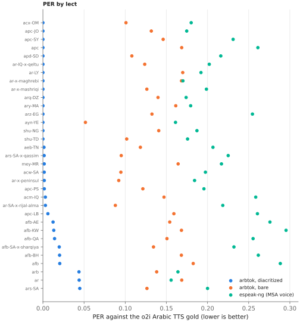

# arbtok documentation

<!-- agent-hint
covers: the reading order of every documentation page of arbtok
source: docs/
generated: no
verify: diff <(ls docs/*.md | xargs -n1 basename | grep -v '^index.md$' | sort) <(grep -oP '^\| \[[^]]*\]\(\K[a-z0-9_-]+\.md' docs/index.md | sort)
see: README.md, AGENTS.md
-->

`arbtok` turns Arabic text into IPA for Modern Standard Arabic, Classical Arabic and 30 or more regional varieties, and it restores the missing short vowels first.

<picture>
  <source media="(prefers-color-scheme: dark)" srcset="img/lect-benchmark-dark.svg">
  
</picture>

`img/plot_lect_benchmark.py` makes this figure from `benchmarks/lect_results.json`. The gold is LLM-generated from cited spec rules, so the figure measures agreement with the rules and not native speech. [Per-lect benchmarks](benchmarks.md) gives the full limits.

## Quickstart

```bash
pip install --pre arbtok
```

```python
from arbtok.plugin import ArbtokG2PPlugin

bare = "ذهب الولد الى المدرسة"
print(ArbtokG2PPlugin(lang="ar-TN").transcribe(bare))
# ˈðahab ˈalwalad ˈʔilɛː lˈmudrasa
```

## Pages

The pages below follow the reading order, from the first call to the internals and the benchmarks.

| Page | What you get from it |
|---|---|
| [Quickstart](quickstart.md) | Install arbtok and phonemize a first Arabic sentence, bare or in a dialect |
| [Overview](overview.md) | What arbtok adds over orthography2ipa, the three capabilities and the word lattice |
| [Diacritization](tashkeel.md) | How the bundled model and the stem lexicon restore the missing short vowels |
| [Rawi-lattice fusion](rawi-fusion.md) | How the diacritizer scores the readings that a variety's orthography admits |
| [Varieties](dialects.md) | How a language tag resolves to a variety, and where each variety's phonology comes from |
| [Waqf](waqf.md) | The pausal and full registers, and what a dialect lect keeps |
| [Arabizi input](arabizi.md) | How Latin-script Arabic with digit consonants is detected and read |
| [Text normalization](normalization.md) | Clean recognizer output for scoring, and expand written text into spoken words |
| [Code-switched gold](gold-code-switched.md) | The gold set that pins the loanword nativization, row by row |
| [API reference](api.md) | Every public name with its signature and default |
| [Advanced](advanced.md) | The token tree, the espeak baseline, recipes and the sharp edges |
| [Per-lect benchmarks](benchmarks.md) | The per-lect scores, how to reproduce them and what they can claim |
